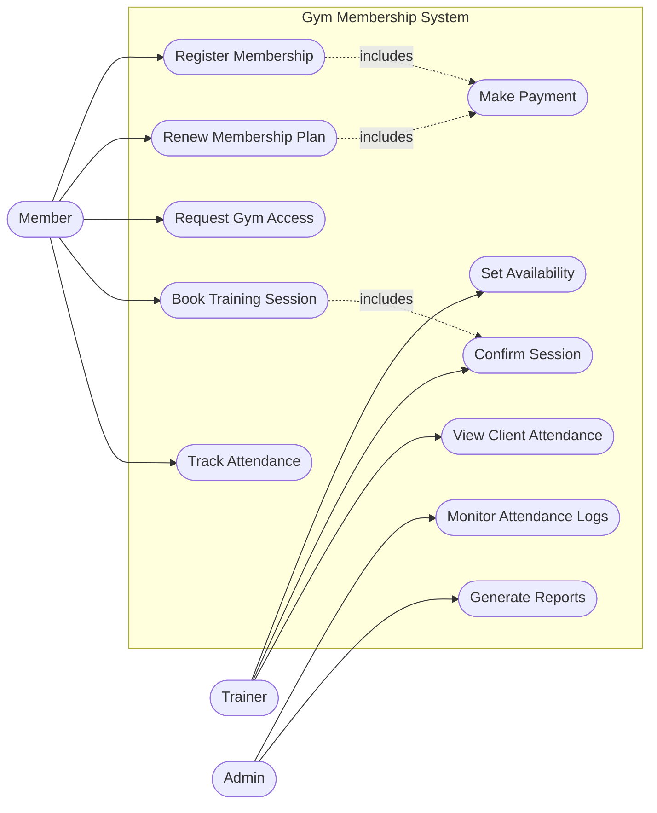
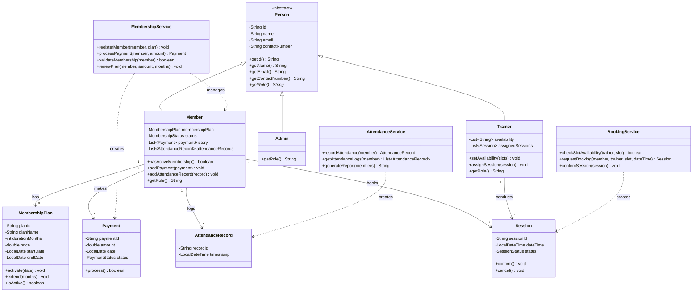
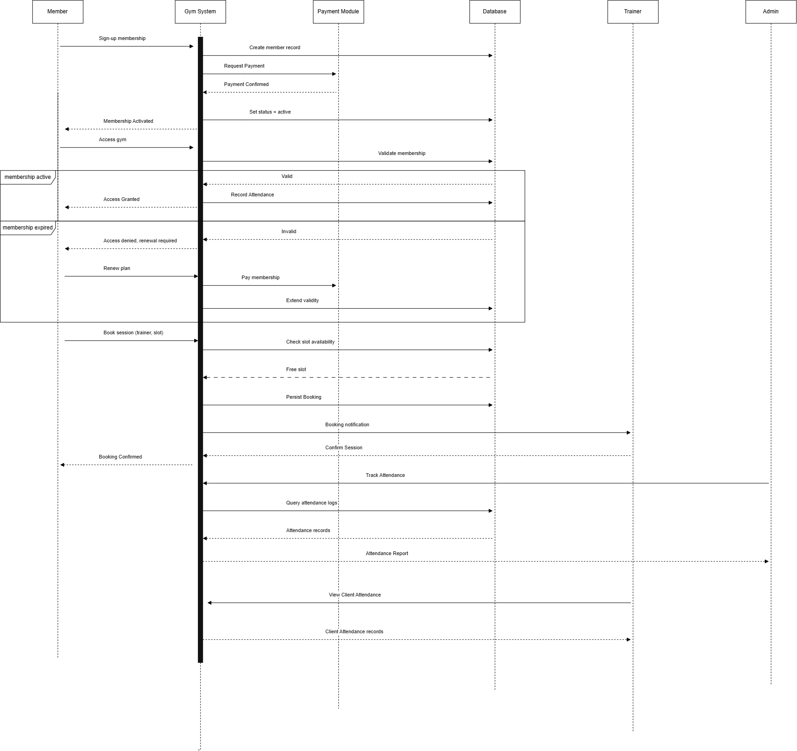
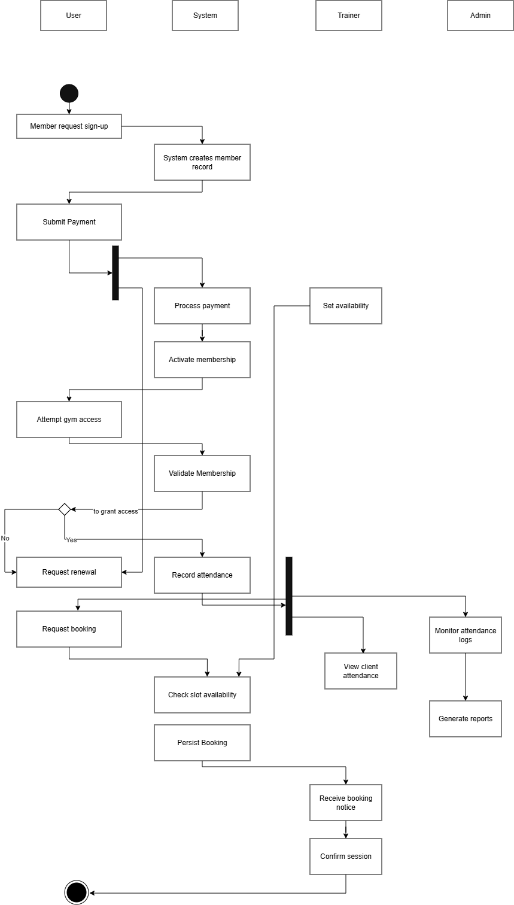

# Gym Membership System

## Project Description
This is my capstone project, a Gym Membership System based on gyms like Anytime Fitness. Right now most small gyms handle memberships, payments, and attendance manually, through spreadsheets, paper logs, or just remembering who paid. That gets messy fast and makes it hard to tell who's actually allowed in the gym or who still owes a renewal. This system puts membership, payments, gym access, attendance, and trainer bookings in one place instead.

Who uses it:
- **Members** sign up, pay, renew when their plan expires, get access to the gym, and book sessions with a trainer.
- **Trainers** set their available time slots, confirm bookings, and check attendance for their own clients.
- **Admins** keep an eye on attendance across all members and pull reports.

## Objectives
- Let members register for a plan, pay, and renew it.
- Check membership status automatically before letting someone into the gym.
- Let members book sessions with a trainer based on real availability.
- Keep a record of member attendance over time.
- Give admins a way to see attendance data and generate reports.

## Key Features
- Membership registration and payment, which activates the plan.
- Membership validation on gym entry, with renewal if it's expired.
- Attendance logging every time a member gets gym access.
- Session booking between members and trainers, with trainer confirmation.
- Attendance reports for admins, and per-client attendance views for trainers.

## Technology Stack
- Java, plain OOP, no frameworks.
- JDK (`javac` / `java`) to build and run, no build tool needed.
- Diagrams done in Mermaid (Use Case, Class) and draw.io (Sequence, Activity).

## Project Structure
```
GYM Membership System/
├── README.md
├── .gitignore
├── src/                        # Source code
│   └── com/gym/
│       ├── Main.java           # Demo entry point wiring the services together
│       ├── model/              # Domain classes (Member, Trainer, Admin, MembershipPlan, Session, Payment, AttendanceRecord)
│       └── service/            # Business logic (MembershipService, BookingService, AttendanceService)
└── docs/                       # Documentation
    ├── project-brief.png       # Original assignment notes for this project
    └── uml/                    # UML diagram files
        ├── use-case-diagram.mmd
        ├── class-diagram.mmd
        ├── sequence-diagram.png
        └── activity-diagram.png
```

## Setup / Execution Instructions
Just needs a JDK (11+) installed, no build tool.

```bash
# From the project root

# 1. Compile everything into a bin/ folder
javac -d bin $(find src -name "*.java")

# 2. Run it
java -cp bin com.gym.Main
```

On Windows PowerShell, step 1 looks like this instead:
```powershell
javac -d bin (Get-ChildItem -Recurse -Filter *.java src | ForEach-Object { $_.FullName })
```

`Main.java` just runs through the main flow as a demo: a member signs up, pays, gets their membership activated, has a gym visit logged as attendance, books a session with a trainer, and an admin pulls an attendance report.

## UML Diagrams

### Use Case Diagram
Actors are Member, Trainer, and Admin. Covers registering a membership, paying, renewing, getting gym access, booking a session, setting availability, confirming a session, and tracking/monitoring attendance plus reports.


Source file: [docs/uml/use-case-diagram.mmd](docs/uml/use-case-diagram.mmd)

### Class Diagram
`Member`, `Trainer`, and `Admin` all extend an abstract `Person` class. Around that are `MembershipPlan`, `Session`, `Payment`, and `AttendanceRecord`, plus the service classes (`MembershipService`, `BookingService`, `AttendanceService`) that hold the actual logic.


Source file: [docs/uml/class-diagram.mmd](docs/uml/class-diagram.mmd)

### Sequence Diagram
Walks through the main flow: sign-up, payment, access validation, attendance logging, session booking, and reporting.



### Activity Diagram
Shows the workflow across Member, System, Trainer, and Admin, including the decision point for granting/denying gym access and the renewal path when a membership has expired.


